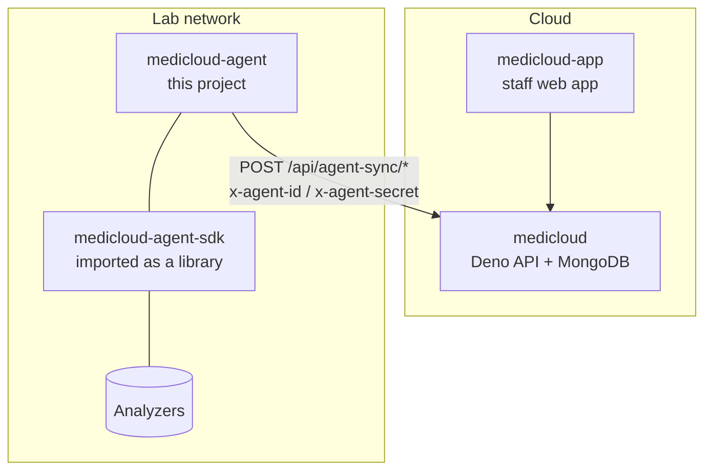
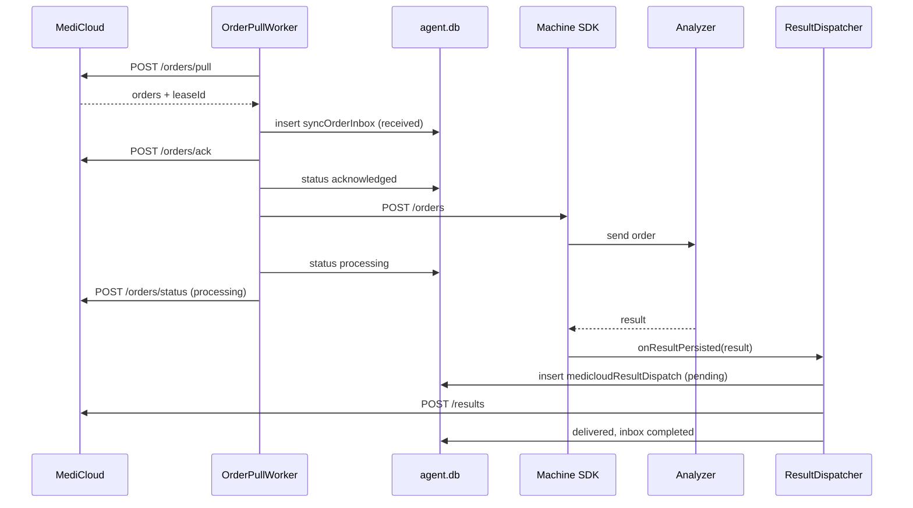

# 1. Overview and system context

## The problem

A lab has several analyzers. Each one speaks its own protocol over a serial
cable or a TCP socket. MediCloud is a cloud system that holds patients,
orders and reports. The cloud cannot reach the analyzers directly. They sit
on a private lab network, often on COM ports of one Windows PC.

The agent runs on that PC and acts as the bridge:

1. It tells MediCloud which analyzers exist, whether they are running, and
   which tests they support (the **heartbeat**).
2. It asks MediCloud for orders meant for those analyzers (the **order pull**).
3. It hands each order to the right analyzer through the SDK.
4. When an analyzer reports a result, the SDK saves it. The agent puts it in
   an **outbox** and uploads it to MediCloud (the **result dispatcher**).
5. It keeps working when the internet drops. Orders and results are stored in
   a local SQLite database and retried later.

It also serves a web **dashboard** for lab staff: analyzer setup, orders,
results and slave management.

## Why "agent" and not a direct integration

- **The network goes one way.** The agent always starts the connection
  (pull model), so no inbound firewall rules are needed at the lab.
- **Labs go offline.** The local outbox means a result already produced by an
  analyzer is not lost when the link is down (see [jobs](05-jobs.md)).
- **One PC may not reach every analyzer.** Master/slave mode lets several lab
  PCs share one MediCloud identity (see [modes](03-modes-and-topology.md)).

## Where this fits

| Project | Role | Relation to the agent |
| --- | --- | --- |
| `medicloud/` | Central API. Holds agent registrations, order dispatches and result receipts (`controllers/agentSync.ts`, `agentOrderDispatches.ts`, `agentRegistrations.ts`). | The agent calls its five `/api/agent-sync/*` endpoints. See [backend sync protocol](08-backend-sync-protocol.md). |
| `medicloud-agent-sdk/` | Analyzer drivers, protocols, transports, and its own SQLite DB (`machines.db`) for profiles, orders, results and catalogs. | Imported through `deno.json` (`@mediCloud/sdk/manager`). The agent mounts its HTTP handler and receives a callback when a result is saved. See [SDK usage](07-sdk-usage.md). The SDK has its own guide. |
| `medicloud-app/` | Staff web app. Staff create agent registrations and dispatch orders to machines there. | No direct link. |

## Two databases, two jobs

| File | Owner | Holds |
| --- | --- | --- |
| `machines.db` (`MEDICLOUD_MACHINES_SDK_DB_PATH`) | SDK | Analyzer profiles, machine orders, raw results, catalogs, turnaround statistics |
| `agent.db` (`MEDICLOUD_AGENT_DB_PATH`) | Agent | Sync inbox (MediCloud orders), result outbox, slave registry |

The agent never opens `machines.db` itself. It reads SDK data only through
SDK HTTP routes. This keeps the SDK reusable without the agent.

## The life of one order (short version)

The full walkthrough with file and function names is in [jobs](05-jobs.md).
