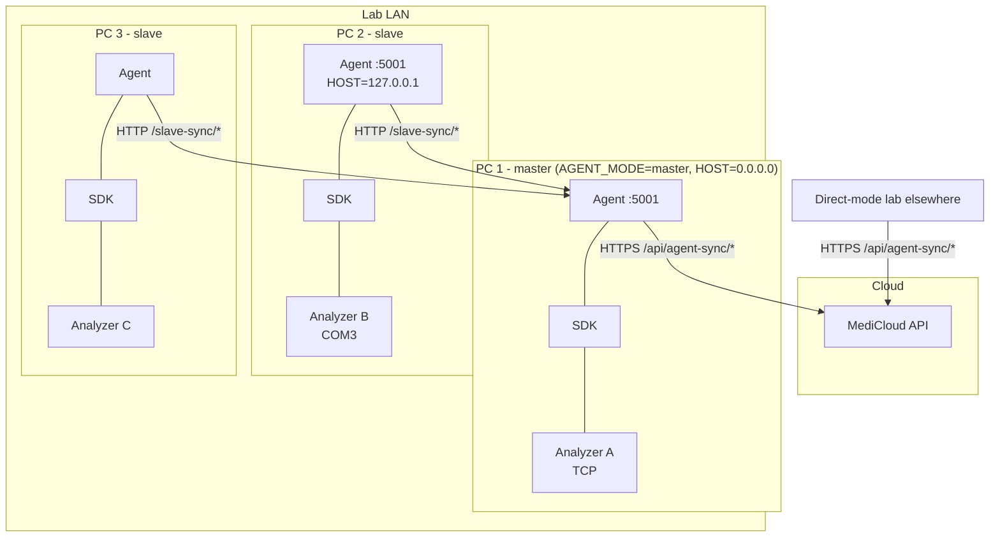

# 3. Modes and topology

`AGENT_MODE` decides what the agent connects to and which routes it serves.
The decision is made once at startup in
[flow/registries.ts](../../flow/registries.ts) and [main.ts](../../main.ts).
Changing the mode needs a restart (and, for an exe, a rebuild, because `.env`
is embedded).

| | `direct` (default) | `master` | `slave` |
| --- | --- | --- | --- |
| Talks to | MediCloud | MediCloud | A master agent |
| Auth headers | `x-agent-*` | `x-agent-*` | `x-slave-*` |
| API prefix | `/api/agent-sync` | `/api/agent-sync` | `/slave-sync` |
| Machines reported | Local only | Local + every active slave's machines | Local only |
| Serves `/slave-sync/*` | No | **Yes** | No |
| Serves `/slave-connection` | No | No | **Yes** |
| `SlaveRegistry` | none | yes | none |
| Needs `MEDICLOUD_*` env | yes | yes | no |

## When to use which

- **direct:** one PC reaches all analyzers. This is the simplest setup and
  the right choice for most labs.
- **master + slaves:** analyzers are spread over several PCs (COM ports on
  different machines, or separate rooms), but the lab should appear as **one**
  agent in MediCloud. Only the master has internet access to MediCloud. Each
  slave needs only LAN access to the master.
- **slave:** a PC whose analyzers belong to a master.

## Deployment topology

Each slave starts every connection. The master never calls a slave. Slaves
report no address.

## How master routing works

1. A slave's heartbeat stores its machines in `slaveRegistry.machinesJson`.
2. The master's heartbeat to MediCloud includes those machines, with
   `profileKey` renamed to `slave:<slaveId>:<driverId>:<profileId>`,
   `isSlaveOwned: true` and `slaveId` set
   ([flow/sync/capabilities.ts](../../flow/sync/capabilities.ts)
   `getUpstreamCapabilities`). Only slaves with a heartbeat in the last
   2 minutes are included.
3. MediCloud dispatches an order to that profile key.
4. When the master pulls it, `storeAndAcknowledge`
   ([jobs/orderPull.ts](../../jobs/orderPull.ts)) sets
   `targetSlaveId`. The master's own resume step skips rows that have a
   `targetSlaveId`.
5. The slave pulls from `/slave-sync/orders/pull`. The master strips the
   `slave:<id>:` prefix, so the slave sees a normal `driverId:profileId` key.
6. The slave's results go to the master, which queues them in its own outbox
   and uploads them to MediCloud.

Full detail is in [master ↔ slave sync](09-master-slave-sync.md).

## Mode-specific startup

In slave mode, `loadSlaveConnection()` reads `slave-connection.json`. If
nothing is configured, the workers **do not start** (`resumeAgentWorkers`
returns early in [flow/workers.ts](../../flow/workers.ts)). They start
automatically after a successful "Save and connect" in the dashboard.
