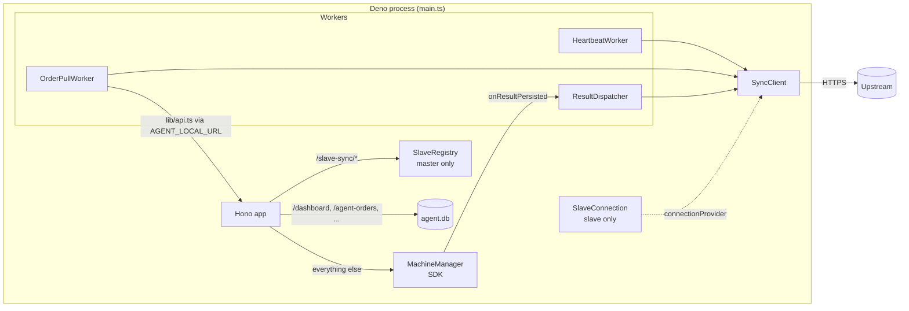
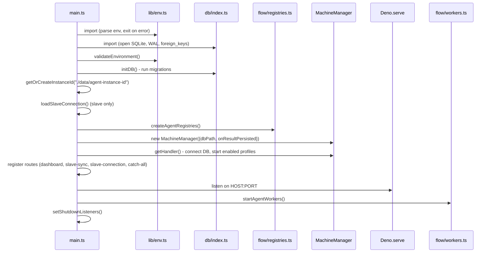
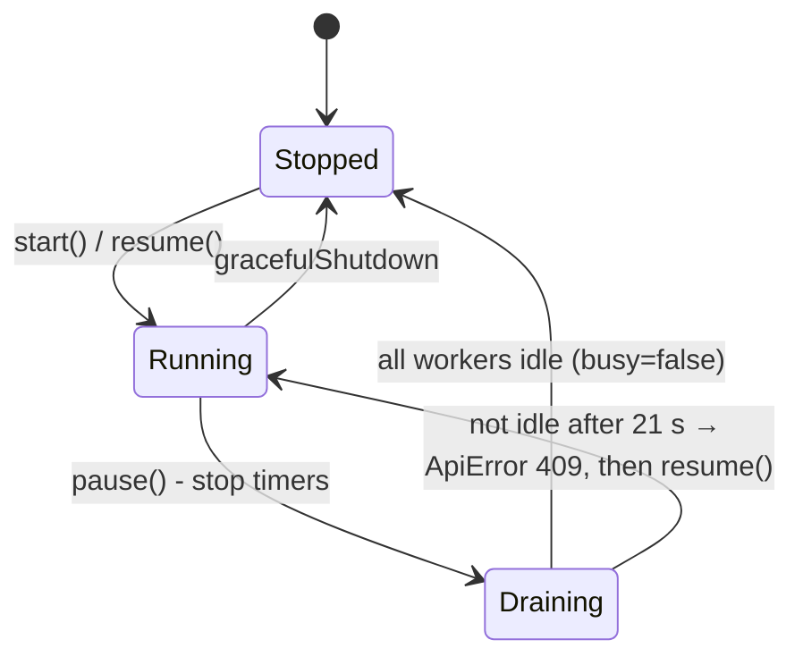

# 4. Architecture

## Folder map

| Path | Purpose |
| --- | --- |
| [main.ts](../../main.ts) | Entry point. Wires everything together. |
| [types.ts](../../types.ts) | Shared TypeScript types (worker bundles, sync auth, persisted SDK result shape). |
| [lib/](../../lib) | `env.ts` (parsed env), `constants.ts` (all timings and limits), `api.ts` (every HTTP call: local SDK and upstream sync), `error.ts` (`ApiError`, `describeError`, `isTransientFailure`), `utils.ts` (instance id, shutdown, JSON files, SQL `LIKE` helper). |
| [schemas/](../../schemas) | Zod schemas. `env.ts` (env), `sync.ts` (wire format shared by the upstream and slave sync), `local.ts` (dashboard and SDK shapes), `slaveConnection.ts` (slave settings file), `shared.ts`. |
| [db/](../../db) | `index.ts` opens SQLite (`node:sqlite`) and runs migrations. `path.ts` resolves the DB path. `tables/` has one Drizzle table per file. `repositories/` holds the shared queries. |
| [drizzle/](../../drizzle) | Generated migrations (`migration.sql` + `snapshot.json` per folder). Embedded in the exe. |
| [flow/](../../flow) | Composition. `registries.ts` builds the workers for the mode. `workers.ts` starts, stops and pauses them. `sync/` has the sync client and capability building. `master/slaveRegistry.ts` manages slaves. `slave/` loads, saves and verifies the master connection. |
| [jobs/](../../jobs) | Background loops: `heartbeat.ts`, `orderPull.ts`, `resultDispatcher.ts`. |
| [routes/](../../routes) | Hono HTTP handlers. `dashboard/*` (dashboard API and static files), `slaveSync/*` (master only), `middleware/dashboardOrigin.ts`. |
| [frontend/](../../frontend) | React dashboard. `src/` is the source and `build/` is prebuilt (served and embedded). |
| [tests/](../../tests) | Deno tests. |
| `binaries/`, `data/` | Build output and runtime data (both git-ignored). |
| [drizzle.config.ts](../../drizzle.config.ts) | drizzle-kit config (schema glob, output folder, DB URL). |

## Component diagram

The agent calls the SDK **over HTTP to itself** (`env.AGENT_LOCAL_URL`), not
through function calls. Hono passes every request that no agent route
matches to `machineHandler`. This keeps the SDK boundary identical to the
boundary of a standalone SDK server.

## Startup sequence

Step by step:

1. **Env.** Importing [lib/env.ts](../../lib/env.ts) parses `Deno.env` with
   `EnvSchema`. Bad values throw before anything else runs.
2. **DB open.** Importing [db/index.ts](../../db/index.ts) creates the DB
   folder, opens `DatabaseSync`, and sets `journal_mode=WAL` and
   `foreign_keys=ON`.
3. `validateEnvironment()` requires the MediCloud identity values, except in
   slave mode.
4. `initDB()` runs the Drizzle migrator on `../drizzle/`.
5. `getOrCreateInstanceId()` ([lib/utils.ts](../../lib/utils.ts)) reads or
   creates a UUID. It is sent as `x-*-instance-id`.
6. `loadSlaveConnection()` ([flow/slave/runtime.ts](../../flow/slave/runtime.ts))
   returns `undefined` unless the mode is slave.
7. `createAgentRegistries()` builds the `SyncClient`, the capability function,
   the three workers, and the `SlaveRegistry` (master only).
8. The SDK `MachineManager` is created with
   `onResultPersisted → resultDispatcher.onResult`. `getHandler()` connects
   `machines.db` and **starts the enabled analyzer profiles** before the HTTP
   server exists. A result produced now is queued at once.
9. Routes are registered in this order: dashboard → slave-sync (master) →
   slave-connection (slave) → `app.all("*")` to the SDK. Order matters: agent
   routes win over SDK routes.
10. `Deno.serve` starts listening.
11. `startAgentWorkers()` ([flow/workers.ts](../../flow/workers.ts)) starts
    the heartbeat (now), the order pull (after 1 s) and the result retry loop
    (after 10 s). In an unconfigured slave, nothing starts yet.
12. Shutdown listeners: SIGINT everywhere, SIGTERM except on Windows.
    `gracefulShutdown` stops the workers, the server and the SDK, then exits.

## Worker lifecycle control

`flow/workers.ts` exposes three operations. The slave connection uses them
when the master settings change.

`busy` means a tick is running at that moment. Draining waits up to
`WORKER_DRAIN_TIMEOUT_MS`, which is the sync timeout (20 s) + 1 s.

## Key design choices (the "why")

- **Durable status columns.** `upstreamStatusPending` and
  `upstreamStatusMessage` exist so that a "processing" or "failed" report is
  not lost when the network is down. It is stored first and sent later.
- **The outbox holds the exact payload.** `payloadJson` in
  `medicloudResultDispatch` is the final upload body, so a retry always sends
  the same bytes with the same `idempotencyKey`.
- **Reconcile.** `ResultDispatcher.reconcile()` rebuilds missing outbox rows
  from the SDK's results. This covers the gap if the agent crashed between
  the SDK saving a result and the agent queuing it.
- **One request at a time per worker.** Each worker has a `running` guard and
  one `setTimeout` chain. There is no `setInterval`, so runs never overlap.
