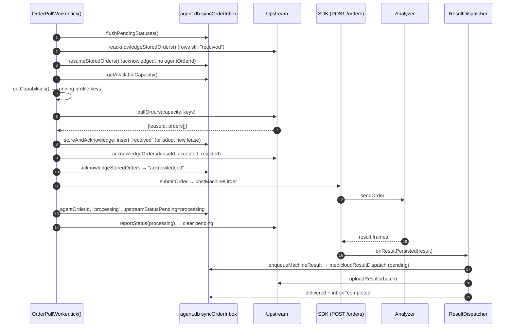
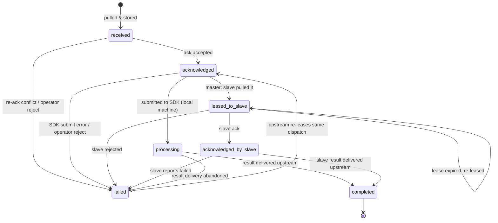
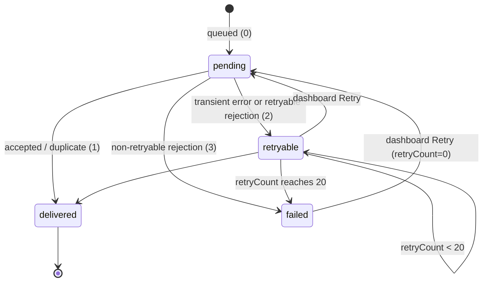

# 5. Background jobs

The three workers live in [jobs/](../../jobs). They all follow one pattern:

- `start()` sets `stopped=false` and schedules the first run with
  `setTimeout`.
- A run sets `running=true`, does the work, and in `finally` sets
  `running=false` and schedules the next run.
- `stop()` clears the timer. A run that is already in progress finishes
  (fetches are not aborted).
- `busy` returns `running` and is used by `pauseAgentWorkers`.

All timings are in [lib/constants.ts](../../lib/constants.ts).

| Constant | Value | Used for |
| --- | --- | --- |
| `DEFAULT_HEARTBEAT_INTERVAL_MS` | 30 000 | default for `MEDICLOUD_PING_INTERVAL_MS` |
| `HEARTBEAT_MIN_INTERVAL_MS` | 1 000 | lower bound for heartbeat delay |
| `HEARTBEAT_MAX_BACKOFF_MS` | 60 000 | heartbeat backoff cap |
| `DEFAULT_ORDER_PULL_INTERVAL_MS` | 10 000 | default for the env variable of the same name |
| `INITIAL_ORDER_PULL_DELAY_MS` | 1 000 | first pull after start |
| `ON_ORDERS_RECEIVED_DELAY_MS` | 250 | next pull right after a non-empty batch |
| `ON_ERROR_DELAY_MS` | 15 000 | next pull after an error |
| `MIN_ORDER_PULL_INTERVAL_MS` | 1 000 | lower bound for `pullAfterMs` |
| `JITTER_MS` | 2 000 | random 0-2 s added to every delay |
| `MAX_CAPACITY` | 50 | maximum in-flight inbox rows |
| `RESULT_UPLOAD_BATCH_SIZE` | 100 | results per upload |
| `RESULT_MAX_RETRY_ATTEMPTS` | 20 | rejection budget per result |
| `RESULT_RETRY_INTERVAL_MS` | 10 000 | result loop period |
| `RESULT_OFFLINE_BACKOFF_MS` | 60 000 | result loop period while offline |
| `SYNC_REQUEST_TIMEOUT_MS` | 20 000 | timeout for every upstream request |
| `ORDER_EXPIRY_MS` | 24 h | `expiresAt` sent to the SDK |
| `SLAVE_LEASE_MS` | 5 min | master → slave lease |
| `SLAVE_ACTIVE_WINDOW_MS` | 2 min | a slave counts as "active" within this window |

## Heartbeat — [jobs/heartbeat.ts](../../jobs/heartbeat.ts)

Purpose: tell upstream that the agent is alive and which machines and tests
it has. MediCloud uses this list to offer machines for dispatch.

1. `beat()` calls `getCapabilities()`. That is
   `getLocalMachineCapabilities`, or `getUpstreamCapabilities` on a master
   ([flow/sync/capabilities.ts](../../flow/sync/capabilities.ts)). It reads
   SDK `/profiles`, `/health` and `/catalogs?driver=` for each profile. A
   profile whose catalog fails is skipped with a warning.
2. `syncClient.heartbeat(mode, machines)` posts to `<prefix>/heartbeat`.
3. On success: the next delay is `max(1 s, response.heartbeatAfterMs)`, and
   the `onHeartbeat()` callback runs (slave mode: marks the connection
   "connected").
4. On failure: `failures++`, and the delay is
   `min(60 s, max(1 s, interval) × 2^min(failures, 8))`. The error is logged
   only when its message changes.
5. Next run at delay + 0-2 s jitter.

## Order pull — [jobs/orderPull.ts](../../jobs/orderPull.ts)

Purpose: take work from upstream safely, even when the network drops between
steps.

### Sequence: order pull → machine → result delivery

Walkthrough of `tick()`:

1. **`flushPendingStatuses()`** sends up to 50 rows that have an
   `upstreamStatusPending`. A `processing` status for an already completed
   row is just cleared. The loop stops at the first error
   ([M1](KNOWN_ISSUES.md#m1-one-status-the-backend-refuses-blocks-every-queued-status)).
2. **`reacknowledgeStoredOrders()`** handles upstream rows still in
   `received` (the ack was lost). They are grouped by `leaseId` and the ack
   is sent again. Ids that come back as `acknowledged` move forward. Ids that
   come back as `conflicts` become `failed` ("Lease no longer valid on
   upstream, awaiting re-lease"). The `failed` status is allowed to go back
   to `acknowledged` if upstream leases the same dispatch again.
3. **`resumeStoredOrders()`** submits every `acknowledged` upstream row that
   has no `agentOrderId` and no `targetSlaveId`. The profile id is the last
   `:` part of `profileKey`. On error: `markFailed()`.
4. **Capacity** = `50 − count(IN_FLIGHT_STATUSES)`. At 0, the pull is
   skipped.
5. **Pull** with `availableProfileKeys` = the keys of capabilities with
   `running: true`.
6. **`storeAndAcknowledge()`** handles each order:
   - It is rejected with `PROFILE_UNAVAILABLE` if no running machine has
     that `profileKey`.
   - It is rejected with `UNSUPPORTED_TEST` if a test is not in that
     machine's `catalogTests`.
   - Otherwise it is inserted as `received`, or the existing row adopts the
     new `leaseId`.

   Then **one** ack is sent for the whole batch, and the rows that come back
   acknowledged move to `acknowledged`
   ([db/repositories/orderAcknowledgements.ts](../../db/repositories/orderAcknowledgements.ts)).
   Only rows in `received` or `failed` change, so a repeated ack never moves
   progress backwards.
7. `resumeStoredOrders()` runs again to submit the new rows at once.
8. Next delay: 250 ms after orders, `max(1 s, pullAfterMs || interval)` when
   idle, 15 s after an error. Each delay gets 0-2 s jitter.

**`submitOrder()`** posts to SDK `/orders` with `expiresAt = now + 24 h`.
Then it updates the row only where the status is still `acknowledged` or
`processing`. A very fast result may already have completed the row. Then it
reports `processing`. If that report fails, the pending column keeps the
status for step 1 to send later.

### Order (inbox) status

Local dashboard orders (`source = local`) are inserted directly as
`processing`. They become `completed` as soon as the SDK reports their result.
They are never uploaded.

There is **no timeout** that moves rows out of `processing` or
`acknowledged_by_slave`
([H2](KNOWN_ISSUES.md#h2-inbox-rows-never-expire-so-capacity-leaks-until-pulling-stops)).

## Result delivery — [jobs/resultDispatcher.ts](../../jobs/resultDispatcher.ts)

Purpose: make sure every analyzer result reaches upstream exactly once.
Network loss must not lose a result.

1. **Entry points:**
   - `onResult(result)` is called by the SDK after it saves a result.
   - `enqueueFromSlave(item)` is called on a master by `/slave-sync/results`.
   - `reconcile()` runs every 60 s and through the dashboard.
   - `retryDelivery(id)` is called from the dashboard.
2. **`enqueueMachineResult()`**
   ([db/repositories/resultQueue.ts](../../db/repositories/resultQueue.ts))
   finds the inbox row by `agentOrderId`. If none is found, it tries a
   fallback: a single upstream row in `acknowledged` or `processing` with
   the same `sampleId` and profile id and no `agentOrderId`
   ([H3](KNOWN_ISSUES.md#h3-fallback-matching-can-attach-an-old-result-to-a-new-dispatch)).
   - For a local order, it marks the order `completed` and stops.
   - Otherwise it builds the upload item. The key is
     `idempotencyKey = <dispatchId>:<sdkResultId>`, and each analyte is
     projected with `toUploadAnalyte` (all values become strings).
   - It inserts with `ON CONFLICT DO NOTHING`. The unique `agentResultId`
     and `idempotencyKey` columns make repeats harmless.
3. **`flush()`** (one at a time) selects up to 100 rows with status
   `pending` or `retryable` and `retryCount < 20`, and uploads them as one
   batch with a new `batchId`.
4. **Response handling:**
   - Keys in `accepted` or `duplicates` → status `delivered`, `sentAt` set,
     inbox rows `completed`.
   - Keys in `rejected` → `retryCount+1`. The status becomes `failed` if the
     rejection is not retryable or the budget is used up, otherwise
     `retryable`.
   - Rows that end `failed` → `abandon()`: the inbox row becomes `failed`
     with a pending `failed` status, and the failure is reported upstream.
5. **Thrown errors:**
   - Transient (no response, 408, 429, 5xx, timeout) → rows become
     `retryable` **without** using budget, and `offline=true` switches the
     loop to 60 s.
   - Any other error (401, 400, a local Zod error) → every row in the batch
     uses one attempt
     ([H1](KNOWN_ISSUES.md#h1-non-network-failures-use-up-the-whole-batchs-retry-budget-in-about-35-minutes)).
6. **`runLoop()`** reconciles if 60 s have passed, then flushes, then
   reschedules (10 s, or 60 s while offline, plus jitter).

### Result delivery status

**Duplicates:** the backend keys receipts by `idempotencyKey`. If an upload
succeeded but the reply was lost, the retry is reported as `duplicates` and
the row is marked delivered. A result is therefore never applied twice.

## When an analyzer result exists but has not reached MediCloud

Start by checking three records in order: the SDK result, the agent's order inbox row, and the agent's delivery row. These are separate because saving a result locally and uploading it can succeed at different times.

1. [Result queue](../../db/repositories/resultQueue.ts) first looks up the SDK order ID in the inbox. A fast analyzer can answer before the agent records that ID. In that case the queue can link the result only when exactly one eligible upstream inbox row matches the sample ID and local profile. A dashboard-only local order is marked complete locally and creates no upload.
2. For an upstream order, the queue builds a delivery row keyed by dispatch ID and SDK result ID. Inserting the same result again does not create another row. The [dispatcher](../../jobs/resultDispatcher.ts) periodically scans stored SDK results to rebuild missing delivery rows.
3. A batch response treats both accepted and duplicate keys as delivered and updates the related inbox status. If a delivery row is already present, check its status and error before troubleshooting the SDK. Manual retry resets a non-delivered row and its inbox status, then attempts delivery again.
