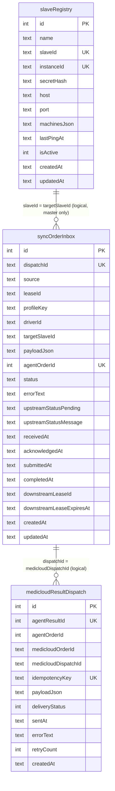

# 6. Local database (`agent.db`)

- **Engine:** SQLite through Deno's built-in `node:sqlite` (`DatabaseSync`),
  wrapped by Drizzle ORM (`drizzle-orm/node-sqlite`). See
  [db/index.ts](../../db/index.ts).
- **Pragmas:** `journal_mode = WAL` (so `-wal` and `-shm` files appear next to
  the DB) and `foreign_keys = ON`. No foreign keys are declared at present.
- **Path:** `MEDICLOUD_AGENT_DB_PATH`, resolved to an absolute path in
  [db/path.ts](../../db/path.ts). `DB_PATH` is the `file:` URL form used by
  drizzle-kit.
- The DB opens **when the module is imported**, so any file that imports `db`
  opens the database.
- The calls are synchronous under the hood. `await` and `Promise.all` work,
  but nothing actually runs in parallel.

## Entity diagram

The relations are logical only (no foreign keys). All times are ISO-8601
strings.

## `syncOrderInbox` — [db/tables/syncOrderInbox.ts](../../db/tables/syncOrderInbox.ts)

One row per order this agent holds: pulled from upstream, or created locally
in the dashboard.

| Column | Purpose |
| --- | --- |
| `id` | Local key. Used by dashboard URLs (`/agent-orders/:id`). |
| `dispatchId` | Upstream dispatch id (a MongoDB ObjectId string) or `local:<uuid>`. Unique, so the same dispatch is never stored twice. |
| `source` | `upstream` (default) or `local`. Local rows are never uploaded or acked. |
| `leaseId` | The upstream lease under which the row was pulled. It is replaced when upstream leases the dispatch again. `local` for local rows. |
| `profileKey` | `driverId:profileId`, or `slave:<slaveId>:driverId:profileId` on a master. |
| `driverId` | SDK driver id. |
| `targetSlaveId` | Master only: the slave that owns the machine. `NULL` means the order runs locally. |
| `payloadJson` | The full order as pulled (`PulledOrderSchema`). |
| `agentOrderId` | SDK order id once submitted. Unique. It is the key that links a result back to this row. |
| `status` | See the state diagram in [jobs](05-jobs.md). |
| `errorText` | Last error shown in the dashboard. |
| `upstreamStatusPending` | `processing` or `failed` waiting to be reported upstream. |
| `upstreamStatusMessage` | The message that goes with that status. |
| `receivedAt`, `acknowledgedAt`, `submittedAt`, `completedAt` | Timeline. |
| `downstreamLeaseId`, `downstreamLeaseExpiresAt` | Master only: the lease given to the slave (5 min). |
| `createdAt`, `updatedAt` | Bookkeeping. |

Indexes: `(status, receivedAt)` and `(targetSlaveId, status, downstreamLeaseExpiresAt)`.

## `medicloudResultDispatch` — [db/tables/medicloudResultDispatch.ts](../../db/tables/medicloudResultDispatch.ts)

The **outbox**. One row per result to deliver upstream.

| Column | Purpose |
| --- | --- |
| `id` | Local key (`/external-results/:id/retry`). |
| `agentResultId` | SDK result id. Unique. `NULL` for results forwarded from a slave (several NULLs are allowed). |
| `agentOrderId` | SDK order id that produced the result (the slave's id for forwarded results). |
| `medicloudOrderId` | MediCloud order id (`orderId` in the pulled payload). |
| `medicloudDispatchId` | Dispatch id. |
| `idempotencyKey` | `<dispatchId>:<resultId>`. Unique. The backend uses it to drop duplicates. |
| `payloadJson` | The exact `ResultUploadItem` that will be sent. |
| `deliveryStatus` | 0 pending, 1 delivered, 2 retryable, 3 failed. |
| `sentAt` | When upstream accepted it. |
| `errorText` | Last failure. |
| `retryCount` | Rejections counted against the budget of 20. |
| `createdAt` | Queue time. |

Index: `(deliveryStatus, retryCount)`, used by the flush query.

## `slaveRegistry` — [db/tables/slaveRegistry.ts](../../db/tables/slaveRegistry.ts)

Used on a master only. One row per slave slot.

| Column | Purpose |
| --- | --- |
| `name` | Operator label. Set at registration or by the slave's heartbeat `slaveName`. |
| `slaveId` | UUID issued by the master. Unique. |
| `instanceId` | The slave's `agent-instance-id` from its last heartbeat. **Unique** ([M7](KNOWN_ISSUES.md#m7-a-duplicate-slave-instanceid-makes-heartbeats-fail-with-500)). |
| `secretHash` | SHA-256 hex of the slave secret. The plain secret is shown only once. |
| `host`, `port` | Never written by current code (slaves report no address). |
| `machinesJson` | The slave's last reported capabilities. |
| `lastPingAt` | Last successful heartbeat. |
| `isActive` | Starts `false`, set `true` by every heartbeat, `false` by "Mark inactive" ([M5](KNOWN_ISSUES.md#m5-mark-inactive-does-not-stop-a-slave)). |
| `createdAt`, `updatedAt` | Bookkeeping. |

## Repositories — [db/repositories/](../../db/repositories)

| File | Functions |
| --- | --- |
| `external.ts` | Paged dashboard lists: `listAgentOrders`, `listExternalResults`, `listSlaveOrders`, `listSlaveResults`. Search uses `contains()`, an escaped `LIKE`. |
| `orderAcknowledgements.ts` | `acknowledgeStoredOrders`: the guarded `received/failed → acknowledged` change. |
| `resultQueue.ts` | `enqueueMachineResult`, `enqueueSlaveResult`. |
| `slaveConnection.ts` | `hasSynchronizedWork`: is there any upstream order or result in this data dir? |

## Migrations

The folders in [drizzle/](../../drizzle) are applied in name order by
`migrate()` at every startup. Applied migrations are recorded in
`__drizzle_migrations`.

| Folder | Change |
| --- | --- |
| `20260902055553_sturdy_nick_fury` | Create all three tables and the indexes |
| `20260917151053_messy_salo` | `slaveRegistry.lastPingAt` becomes nullable (table rebuild) |
| `20260921110255_unusual_quicksilver` | Add `syncOrderInbox.source`. Rebuilds `slaveRegistry` again with the same shape. |
| `20261001000000_reliable_status` | Add `upstreamStatusPending` and `upstreamStatusMessage` (hand-written timestamp) |
| `20261013000000_slave_name` | Add `slaveRegistry.name` |

The snapshot chain branches after the first migration
([L9](KNOWN_ISSUES.md#l9-the-drizzle-snapshot-history-branches)).

## Changing the schema

1. Edit the table file in `db/tables/`. Add a purpose comment on each field,
   as the existing ones have.
2. `deno task db:generate`. This writes a new `drizzle/<timestamp>_<name>/`
   folder. Check the SQL. SQLite cannot change a column in place, so
   drizzle-kit may produce a table rebuild with `__new_*`. Make sure the
   rebuild copies every column.
3. New columns on existing tables must be nullable or have a default, because
   lab databases already contain rows.
4. Restart the agent (or `deno task db:migrate`). The new folder is embedded
   in the exe on the next compile.
5. Never edit or delete a migration that has already shipped. Lab databases
   record its hash.
