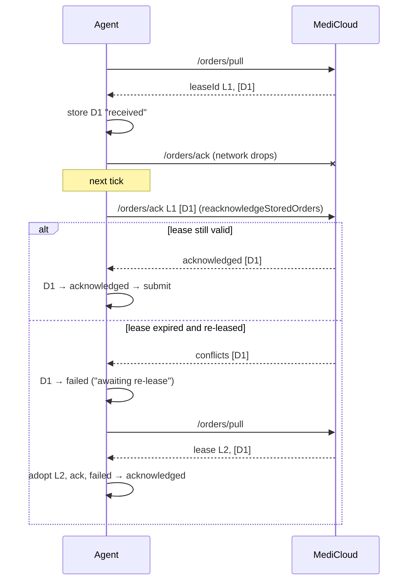

# 8. Backend sync protocol (agent ↔ MediCloud)

Used in **direct** and **master** modes. The client is
[flow/sync/client.ts](../../flow/sync/client.ts), and the HTTP helper is
`syncRequest` in [lib/api.ts](../../lib/api.ts). The server side is
`medicloud/controllers/agentSync.ts` (controller `/agent-sync/`, API prefix
`/api`).

## Common rules

| Item | Value |
| --- | --- |
| URL | `${MEDICLOUD_API_URL}/api/agent-sync/<route>` (a trailing `/` on the base URL is removed) |
| Method | `POST`, JSON body |
| Headers | `x-agent-id` (registration ObjectId), `x-agent-secret`, `x-agent-instance-id` (from `data/agent-instance-id`) |
| Auth on the server | `authenticateAgent` (`helpers/agentSyncAuth.ts`): looks up the registration by `_id` and `sha256(secret)`. Missing or invalid → 401. The instance id is required but not checked. |
| API version | No `x-api-version` header is sent, so the server resolves `latest` (`1.0.0`). |
| Response | `{ status, data: {...}, messages? }`. The agent unwraps `data` (`data?.data ?? data`) and parses it with Zod. |
| Errors | Non-2xx → `ApiError(status)`. The server sends `messages[]`, which the agent does not read ([L1](KNOWN_ISSUES.md#l1-backend-error-messages-are-dropped-http-400-only)). |
| Timeout | 20 s (`SYNC_REQUEST_TIMEOUT_MS`) |
| Validation | The server's validator **rejects unknown properties** and enforces lengths (see C1, M1). |

## The five calls

### 1. `POST /heartbeat` — `SyncClient.heartbeat`

Request:

```json
{ "mode": "direct|master", "protocolVersion": "1.0", "softwareVersion": "1.0.0",
  "machines": [ { "profileKey": "bonavera200:3", "localProfileId": 3, "driverId": "bonavera200",
     "name": "Chem 1", "catalogTests": ["GLU"], "catalog": [ { "testCode": "GLU", "testName": "Glucose",
     "analytes": [ { "code": "GLU", "name": "Glucose", "unit": "mg/dL" } ] } ],
     "running": true, "connected": true, "isSlaveOwned": false, "slaveId": "<only for slave machines>" } ] }
```

Server: rejects with 409 if `mode` differs from the registration's mode.
Otherwise it stores `machines`, `instanceId`, the versions and `lastPingAt`,
and sets `isActive=true`.

Response: `serverTime`, `heartbeatAfterMs` (30 000), `pullAfterMs` (10 000),
`maxOrderBatchSize` (100), `maxResultBatchSize` (100). The agent uses only
`heartbeatAfterMs`.

> **Contract mismatch (C1):** the server allows only `code`, `name` and `unit`
> on analytes. The agent passes along any extra SDK fields (`category`,
> `decimals`), and the server then rejects the whole heartbeat. See
> [KNOWN_ISSUES C1](KNOWN_ISSUES.md#c1-medicloud-rejects-the-heartbeat-when-catalog-analytes-have-extra-fields).

### 2. `POST /orders/pull` — `SyncClient.pullOrders`

Request: `{ capacity, availableProfileKeys }`.

Server:
- An empty `availableProfileKeys` returns no orders.
- Otherwise it picks dispatches for this registration whose
  `targetProfileKey` is in the list and whose status is `pending`, or
  `leased` with an expired lease. Oldest first, up to
  `clamp(capacity, 1..100)`.
- It leases them with a new `leaseId` for 5 minutes.

Response:
`{ leaseId?, leaseExpiresAt?, pullAfterMs, orders: [{ dispatchId, orderId, profileKey, targetSlaveId?, driverId, sampleId, sampleType?, rackPosition?, patient: {id?, name, dob?, sex?}, tests[], payloadVersion }] }`.

### 3. `POST /orders/ack` — `SyncClient.acknowledgeOrders`

Request: `{ leaseId, accepted: [{dispatchId}], rejected: [{dispatchId, code, message}] }`.
The agent's codes are `PROFILE_UNAVAILABLE` and `UNSUPPORTED_TEST`.

Server: each accepted id whose `leaseId` still matches becomes `acknowledged`.
Otherwise it goes into `conflicts`. Each rejected id becomes `failed` and its
lease is released. Response: `{ acknowledged[], conflicts[] }`.

The server also accepts `accepted[].localOrderId`, but the agent never sends
it ([L5](KNOWN_ISSUES.md#l5-ack-never-sends-localorderid)).

### 4. `POST /orders/status` — `SyncClient.reportStatus`

Request: `{ updates: [{ dispatchId, status: "processing"|"failed", message? }] }`.
The server requires at least one update and `message` ≤ 1000 characters
([M1](KNOWN_ISSUES.md#m1-one-status-the-backend-refuses-blocks-every-queued-status)).

Server: updates are matched by agent, not by lease. Dispatches already
`completed`, `result_received`, `review_required` or `cancelled` are left
alone. Response: `{ updated[] }`.

Senders:
- `submitOrder` (processing)
- `markFailed`
- `abandon`
- `flushPendingStatuses`
- the dashboard reject route
- on a master, the slave ack and status routes

### 5. `POST /results` — `SyncClient.uploadResults`

Request: `{ batchId, results: [{ idempotencyKey, dispatchId, localOrderId, localResultId, sampleId, receivedAt, analytes: [{ assayNo, assayName?, resultType?, value?, qualitative?, unit?, lowReference?, highReference?, abnormalFlag?, status?, completedAt? }] }] }`.
All analyte values are strings (`toUploadAnalyte` in [lib/utils.ts](../../lib/utils.ts)).

Server, for each item:
- No analytes → rejected `EMPTY_RESULT` (not retryable).
- Unknown dispatch → `DISPATCH_NOT_FOUND` (not retryable).
- Key already seen for the same dispatch → `duplicates` (the stored receipt
  is applied again if needed).
- Key already seen for another dispatch → `IDEMPOTENCY_CONFLICT`.
- Otherwise it stores the receipt, applies it to the order, and adds the key
  to `accepted`.
- An error while applying → `APPLY_FAILED` (retryable).

If the **body** fails validation, the whole batch is refused with 4xx.

## Sequence: one cycle with lost ack recovery



## Status values on both sides

| Agent inbox | MediCloud dispatch (as far as the agent can affect it) |
| --- | --- |
| `received` | `leased` |
| `acknowledged` | `acknowledged` |
| `processing` | `processing` (after the status report) |
| `completed` | set by the server after results (`completed` / `review_required`) |
| `failed` | `failed` (after an ack reject or a `failed` status report) |
