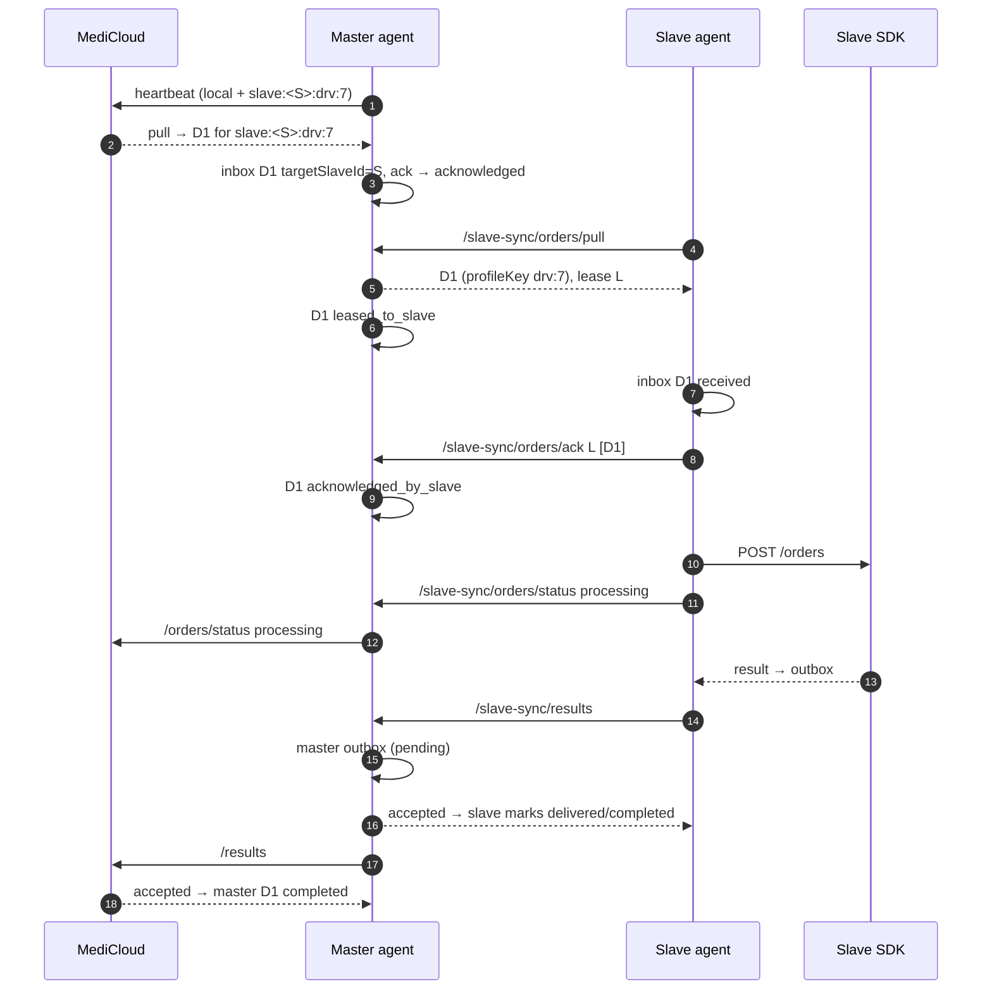

# 9. Master ↔ slave sync

A slave uses **the same workers and wire format** as a direct agent. Only
three things change:
- the base URL is `http://<masterHost>:<masterPort>`;
- the prefix is `/slave-sync`;
- the headers are `x-slave-*`.

The master implements the server side in
[routes/slaveSync/](../../routes/slaveSync). The bodies are checked with the
same Zod schemas in [schemas/sync.ts](../../schemas/sync.ts).

## Credentials and `slave-connection.json`

1. On the master, an operator clicks Manage slaves → Register
   (`POST /slaves/register`, optional `name`).
   [SlaveRegistry.register](../../flow/master/slaveRegistry.ts) creates
   `slaveId` (UUID) and `slaveSecret` (two UUIDs joined), and stores
   `sha256(secret)`. The secret is shown **once**.
2. On the slave, an operator opens Master connection → Add, and enters the
   slave name, master host (no protocol), port, id and secret
   (`PUT /slave-connection`).
3. [SlaveConnection.save](../../flow/slave/connection.ts) does the following:
   - pauses the workers (waits up to 21 s for them to go idle);
   - rejects the change if a master is already configured (409);
   - runs `validateChange`: if a previous identity exists and it differs
     **and** the data dir already holds synchronized work, it refuses (409);
   - `verify` sends a real heartbeat to the master
     ([flow/slave/verify.ts](../../flow/slave/verify.ts));
   - writes the file atomically (temp file + rename, mode 0600; the mode has
     no effect on Windows);
   - resumes the workers.
4. File location: next to `MEDICLOUD_AGENT_DB_PATH`
   (`getSiblingFilePath`). Possible contents:
   - connected: `{ slaveName, masterHost, masterPort, slaveId, slaveSecret }`
   - after Delete: `{ "disconnected": true, "previousIdentity": { masterHost, masterPort, slaveId } | null }`.
     This marker stops the old `MASTER_*` / `SLAVE_*` env values from
     reconnecting the slave after a restart.
5. At startup, `loadSlaveConnection` reads the file:
   - file missing → it falls back to the `MASTER_HOST`, `MASTER_PORT`,
     `SLAVE_ID` and `SLAVE_SECRET` env values;
   - file unreadable or invalid → status shows an error, and the slave stays
     unconfigured.
6. The sync client gets the connection through `connectionProvider` on
   **every request**. While an update is running, `getConnection()` throws
   503 (treated as transient).

The secret is never returned by the API (`hasSecret: true` only).

## Routes on the master

All four routes check the body first (400 on bad input), then
`requireSlave` (401 unless `x-slave-id` and `x-slave-secret` match a stored
hash). They **do not** check `isActive`
([M5](KNOWN_ISSUES.md#m5-mark-inactive-does-not-stop-a-slave)).

| Route | Handler | What it does |
| --- | --- | --- |
| `POST /slave-sync/heartbeat` | [heartbeat.ts](../../routes/slaveSync/heartbeat.ts) | `registry.ping()` stores machines, `instanceId`, the name and `lastPingAt`, and sets `isActive=true`. Replies with the master's own `MEDICLOUD_PING_INTERVAL_MS` and `DEFAULT_ORDER_PULL_INTERVAL_MS`. |
| `POST /slave-sync/orders/pull` | [orders.ts](../../routes/slaveSync/orders.ts) | Picks rows where `targetSlaveId = caller` and the status is `acknowledged`, or `leased_to_slave` with an expired lease, up to `capacity`. Claims each row with a conditional update, which sets `leased_to_slave`, a new `downstreamLeaseId` and a 5-minute expiry. Returns the orders with the `slave:<id>:` prefix removed and without `targetSlaveId`. **Ignores** `availableProfileKeys`. |
| `POST /slave-sync/orders/ack` | orders.ts | Accepted rows go from `leased_to_slave` to `acknowledged_by_slave` (if the lease matches). If a row is already further along under the same lease, it still counts as acknowledged. Rejected rows become `failed` and the failure is reported to MediCloud (fire-and-forget, and also stored as pending). |
| `POST /slave-sync/orders/status` | orders.ts | For the caller's rows that are not completed: `processing` sets `acknowledged_by_slave` and `failed` sets `failed`. Stores the pending status and also forwards it at once ([L2](KNOWN_ISSUES.md#l2-the-master-forwards-slave-statuses-twice)). |
| `POST /slave-sync/results` | [results.ts](../../routes/slaveSync/results.ts) | Each item must belong to a row of the caller in `acknowledged_by_slave`, `processing` or `completed`. Otherwise it is rejected `UNKNOWN_DISPATCH` (not retryable). Accepted items go to the master outbox with the slave's own `idempotencyKey` (insert with conflict-ignore). `duplicates` is always empty. |

## Sequence: one slave order end to end

## Conflict handling and stale data

- **Lease expiry.** If a slave does not ack within 5 minutes, the row can be
  leased again to the **same** slave. Its re-ack with the old lease then
  conflicts, and the slave marks its copy `failed`. The next pull adopts the
  new lease (see [backend protocol](08-backend-sync-protocol.md)).
- **Slave liveness.** The master reports a slave's machines to MediCloud only
  while `lastPingAt` is within 2 minutes. After that, MediCloud stops
  dispatching to them. Orders already routed to the slave stay where they are.
- **Identity guard.** A slave refuses a new master or slave id while its data
  dir holds synchronized work, so results are never sent under the wrong
  identity. To change identity, use a separate data directory.
- **Slave status in the dashboard** (`SlaveConnection.getStatus`):
  - `unconfigured`: no settings;
  - `connecting`: configured, no heartbeat yet;
  - `connected`: last heartbeat ≤ 2 min ago;
  - `disconnected`: last heartbeat failed, or is stale.
