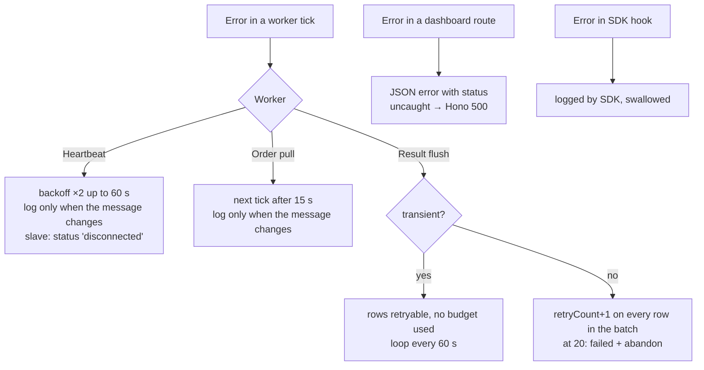

# 11. Errors and logging

## Error types — [lib/error.ts](../../lib/error.ts)

- **`ApiError(message, status, body?)`** is thrown by every HTTP helper in
  [lib/api.ts](../../lib/api.ts) on a non-2xx reply. Code inside the agent
  also uses it to carry an HTTP status. For example, `SlaveConnection` throws
  503 "configure the master" and 409 "already running".
- **`describeError(error)`** turns any error into one log line. It turns
  `fetch failed` into "cannot reach upstream at … (is MediCloud running?)".
- **`isTransientFailure(error)`** returns `true` for:
  - `ApiError` with status 0, 408, 429 or ≥ 500;
  - `TypeError` (network failure);
  - `DOMException` (timeout or abort).

  The result dispatcher uses it to decide whether a failure counts against
  the retry budget. Everything else is treated as a "real refusal",
  including 401, 404 and Zod errors
  ([H1](KNOWN_ISSUES.md#h1-non-network-failures-use-up-the-whole-batchs-retry-budget-in-about-35-minutes)).

## Where errors go

- **Durable status:** a failed `processing` or `failed` report stays in
  `upstreamStatusPending` and is retried at the start of each pull tick.
- **Fire-and-forget calls** (dashboard reject, master forwarding of slave
  statuses) always have a `.catch(console.error)`, so they cannot cause an
  unhandled rejection.
- Worker loops are started with `void this.tick()`. Each tick catches all its
  errors, so no unhandled rejection was found in the jobs.

## Logging

Logs go to the console only. There is no log file and no log level setting.
Each line starts with a prefix that names the component:

| Prefix | Source |
| --- | --- |
| `[Agent] Listening on …` | `main.ts` |
| `SQLite database: …` | `db/index.ts` |
| `[HeartbeatWorker] OK - N machines reported, M connected` / `Failed: …` | heartbeat |
| `[OrderPullWorker] Pulled …`, `Ack sent: …`, `Submitted …`, `Polled, no pending orders` (every 6th idle cycle), `At capacity, skipping pull.` | order pull |
| `[ResultDispatcher] Queued result #…`, `Uploaded batch …`, `Flush failed: …`, `SDK result scan failed` | dispatcher |
| `[capabilities] Skipped a profile/slave` | capability building |
| `[SlaveSync] …` | master slave routes |
| `[dashboard] …` | dashboard routes |
| `[Machine-Manager] …`, `onResultPersisted hook error` | SDK |

For a compiled exe, send the console output to a file
(`lis-middleware.exe > agent.log 2>&1`) or run it under a service wrapper
that captures stdout.
