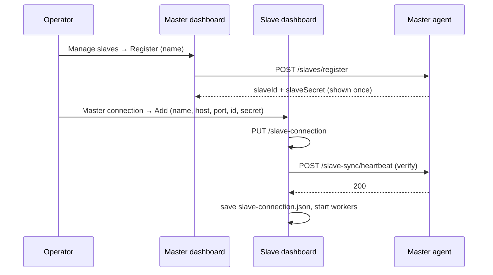

# 13. How-to recipes

## Add a new background job

1. Create `jobs/myJob.ts` and copy the shape of
   [jobs/heartbeat.ts](../../jobs/heartbeat.ts):
   - fields `timer`, `running` and `stopped = true`;
   - `start()`, `stop()` and `get busy()`;
   - a private `schedule(delay)` that does nothing when stopped;
   - a run method that returns early if `running`, catches **all** errors,
     and reschedules in `finally`.
2. Put the timings in [lib/constants.ts](../../lib/constants.ts), with a
   comment that explains why each value was chosen.
3. Build it in `createAgentRegistries()`
   ([flow/registries.ts](../../flow/registries.ts)) and add it to
   `AgentRegistriesResult` and `AgentWorkers` in [types.ts](../../types.ts).
4. Start and stop it in `resumeAgentWorkers` and `stopAgentWorkers`, and
   include its `busy` in `pauseAgentWorkers`
   ([flow/workers.ts](../../flow/workers.ts)). Stop it in `gracefulShutdown`
   ([lib/utils.ts](../../lib/utils.ts)).
5. If it talks upstream, use `SyncClient` so that slave mode and connection
   changes work without extra code.

## Add a new dashboard API

1. Add a Zod schema for the query or body in
   [schemas/local.ts](../../schemas/local.ts).
2. Add a handler file in `routes/dashboard/`. Use `validator("json" | "query", ...)`
   and return `c.json({ error }, status)` on failure. Put DB queries in
   `db/repositories/`.
3. Register it in [routes/dashboard.ts](../../routes/dashboard.ts). The path
   **must not clash** with an SDK route (`/orders`, `/results`, `/profiles`,
   `/catalogs`, `/drivers`, `/health`, `/test-statistics`). Agent routes are
   registered first and win.
4. For actions that change state, consider `requireDashboardOrigin`.
5. Frontend: add the endpoint and its SWR key to
   `frontend/src/lib/api.ts`, add the types to `types/api.ts`, then rebuild.

## Add a DB column

1. Add the field to `db/tables/<table>.ts`, with a purpose comment. Make it
   nullable or give it a default.
2. `deno task db:generate`, then read the new `migration.sql`.
3. Use the column in a repository or job. Restart: migrations run at
   startup.
4. Add a test that sets a temporary `MEDICLOUD_AGENT_DB_PATH`.
5. See [local database](06-local-database.md#changing-the-schema).

## Set up a new lab site (direct mode)

1. In MediCloud, create an **agent registration** with mode `direct`. Note
   its id (an ObjectId), its secret and the account id.
2. On the build machine, write a `.env`:
   ```dotenv
   AGENT_MODE=direct
   MEDICLOUD_AGENT_HTTP_HOST=127.0.0.1
   MEDICLOUD_AGENT_HTTP_PORT=5001
   MEDICLOUD_API_URL=https://<medicloud-host>     # no /api
   MEDICLOUD_AGENT_ID=<registration id>
   MEDICLOUD_AGENT_SECRET=<secret>
   MEDICLOUD_ACCOUNT_ID=<account id>
   MEDICLOUD_AGENT_DB_PATH=C:\MediCloudAgent\data\agent.db
   MEDICLOUD_MACHINES_SDK_DB_PATH=C:\MediCloudAgent\data\machines.db
   ```
   Absolute paths avoid the working-directory trap
   ([M8](KNOWN_ISSUES.md#m8-data-paths-depend-on-the-working-directory-and-the-instance-id-path-ignores-the-db-setting)).
3. `deno task compile:agent:win`. This embeds the `.env`.
4. On the lab PC:
   - copy the exe to `C:\MediCloudAgent\`;
   - install Node.js if any analyzer uses a COM port;
   - start the exe **from that folder**, so `data\agent-instance-id` lands
     beside it.
5. Open `http://127.0.0.1:5001/dashboard/` → Analyzers → add a profile for
   each analyzer (driver plus connection settings) → Start.
6. Check the console for `[HeartbeatWorker] OK - N machines reported`.
   Check that MediCloud shows the agent online with its machines. If the
   heartbeat fails, see
   [troubleshooting](14-troubleshooting.md).
7. Dispatch a test order from MediCloud. Watch it in Orders → "Orders" tab,
   then in Results → "External Results".

## Connect a slave



1. The master runs `AGENT_MODE=master` with
   `MEDICLOUD_AGENT_HTTP_HOST=0.0.0.0` (or its LAN IP). Open the port in the
   Windows firewall.
2. The slave runs `AGENT_MODE=slave` with no master values in `.env`.
3. Register on the master, enter the values on the slave, and click Save and
   Connect.
4. Within 2 minutes, the master's Control Center shows the slave online, and
   its machines appear in MediCloud as `slave:<id>:...` profiles.
5. To move a slave to another master, use **a new data directory**. The
   identity guard blocks the change while old work exists.

## Rotate a slave secret

The code has no rotate function. Register a new slot, then on the slave:
Delete the connection → add the new one. The new slot means a new identity,
so the slave must have no synchronized work, or use a fresh data dir. Then
delete the old slot on the master. Its open orders are stranded
([M6](KNOWN_ISSUES.md#m6-deleting-a-slave-strands-its-orders)).
