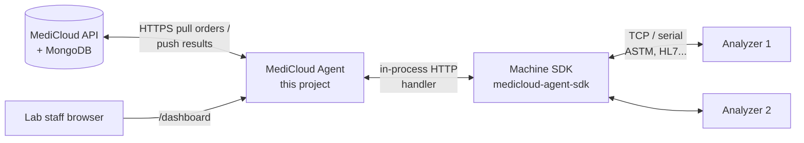

# MediCloud Agent developer guide

Start here. This guide is for developers and field engineers who have never
seen the agent code.

The agent is a small Deno program that runs **inside a laboratory**. It
connects the lab's analyzers (blood counters, chemistry machines and so on)
to the MediCloud cloud. It pulls test orders from MediCloud, sends them to
the analyzers, and delivers the results back.

## Read in this order

| # | Page | What you learn |
| --- | --- | --- |
| 1 | [Overview and system context](01-overview.md) | The problem the agent solves, and where it fits next to MediCloud and the SDK |
| 2 | [Install, run and build](02-install-run-build.md) | Running from source, compiling the exe, the data folder, **every env variable** |
| 3 | [Modes and topology](03-modes-and-topology.md) | Direct, master and slave modes, and when to use each |
| 4 | [Architecture](04-architecture.md) | Folder map, startup sequence, how the parts connect |
| 5 | [Background jobs](05-jobs.md) | Heartbeat, order pull, result delivery: timing, retries, state |
| 6 | [Local database](06-local-database.md) | Every table and column, migrations, changing the schema |
| 7 | [How the agent uses the SDK](07-sdk-usage.md) | The machine SDK boundary |
| 8 | [Backend sync protocol](08-backend-sync-protocol.md) | Every call to the MediCloud API |
| 9 | [Master ↔ slave sync](09-master-slave-sync.md) | Every `/slave-sync` route, auth, `slave-connection.json` |
| 10 | [Dashboard](10-dashboard.md) | Every dashboard route and API, frontend structure, rebuilding |
| 11 | [Errors and logging](11-errors-logging.md) | How failures are classified and logged |
| 12 | [Testing](12-testing.md) | The test suite and how to run it |
| 13 | [How-to recipes](13-how-to-recipes.md) | Add a job, an API, a DB column; set up a lab; connect a slave |
| 14 | [Troubleshooting runbook](14-troubleshooting.md) | Symptoms → causes → fixes |
| 15 | [Glossary](15-glossary.md) | Terms used in the code |
| 16 | [Slave connection lifecycle](16-slave-connection-lifecycle.md) | Saved connection state, identity changes, and worker coordination |

**[KNOWN_ISSUES.md](KNOWN_ISSUES.md)** lists the bugs found in the
2 November 2026 review, most severe first. Read it before a field install.
Issue C1 (rejected heartbeats) and H1/H2 (lost results, capacity leak) affect
production directly.

## The 30-second picture



## Quick start (developer)

```powershell
cd medicloud-agent
copy .env.example .env      # then fill in the values, see page 2
deno task dev               # runs main.ts with --env-file=.env
# open http://127.0.0.1:5001/dashboard/
```

## Conventions in this guide

- Links like [main.ts](../../main.ts) point to the real code.
- "Upstream" means whatever this agent talks to. That is MediCloud for
  direct and master agents, and the master agent for slaves.
- When the code does not make something clear, the guide says so.
